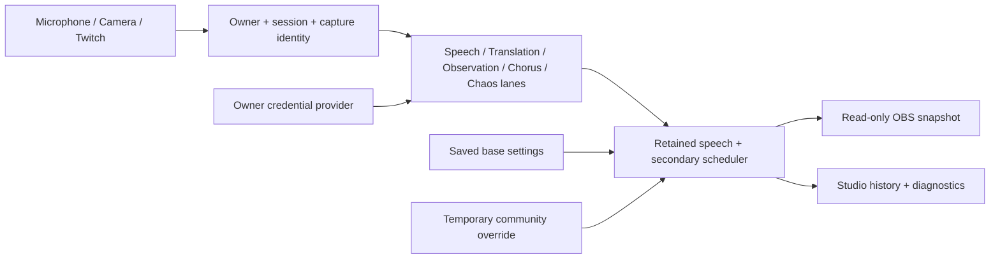

# Local architecture and hosted boundary

## Module ownership

- `server.mjs`: local identity, HTTP routing, storage composition, SSE publishing and shutdown. No media inference or presentation rules.
- `src/contracts.js`: JSDoc context, speech, translation, supplemental cue, community action and settings contracts. Payloads use protocol version 2.
- `src/session.mjs`: session/capture ownership, retained revisions, language generations, optional-lane activation, secondary priority, effects and read models. Injected provider, clock, change callback and work-lane factory.
- `src/scheduler.mjs`: bounded active/pending jobs, abort signals, expiry and counters. Translation allows 2 active + 4 pending; other lanes 1 active + 1 newest pending.
- `src/providers.mjs`: owner-key resolution and OpenAI adapters. Strict structured translation/cue results where supported; audio Chat Completions uses JSON prompting with defensive parsing. Errors omit provider-echoed secrets.
- `src/chat.mjs`: bounded chat evidence, distinct-author limits and quiet baseline.
- `src/twitch.mjs`: OAuth state/cookie validation, token refresh, EventSub reconnect and normalized community events. No outbound chat messages.
- `src/storage.mjs`: memory and atomic local-file adapters; serialized owner credential patches.
- `src/events.mjs`: separate studio/overlay SSE channels, newest-only backpressure buffering, stalled-client disconnect and reconnect snapshot.
- `public/microphone.js`: cancellable browser/OpenAI capture and optional media sampling. `audio-worklet.js` holds one three-second PCM window.
- `public/caption-renderer.js`: shared studio/OBS DOM presentation. Uses textContent, preserves speech meaning and labels fiction. `public/setup.js` owns guided setup; `public/app.js` coordinates controls and capture lifecycle.

## Correctness boundaries

A new live session issues a fresh capture ID and session ID. Every caption/media/status/heartbeat submission must match both and the owner. Replacing/stopping capture rejects old submissions. Pending permission requests release late-arriving tracks. Async connection setup has an abort signal and generation checks.

Speech segments are retained independently (maximum 200), indexed by stable segment ID, sequence and revision. Duplicate finals are idempotent. Translations bind to an exact retained source object, target language and request generation; changing away from a language and back cannot resurrect old responses. Responses received after the display deadline enrich retained history without reappearing on screen. Display reading time starts on successful presentation. New drafts render distinctly beside the previous source/translation pair.

Secondary cues carry source evidence, observation time, language and expiry. Audio/camera evidence refers to the processing input ID, not persisted raw media. Full Context prioritizes fresh observations and lets Chorus fill gaps. One visible line lasts six seconds. Chaos draws from recent real context but produces a separate fictional cue and never enters speech exports. Stopped capture or a lost 30-second lease cancels paid work; inactive modes do not submit jobs.

Saved settings remain the baseline. A single temporary override has an absolute expiry; new accepted effects replace it, never turn another temporary effect into the baseline. Manual changes cancel overrides. Moderator language commands intentionally update saved language. Chat/reward actions share the same permission/cooldown/deduplication path.

## Local HTTP interfaces

| Interface | Purpose |
|---|---|
| `/`, `/overlay` | Studio and transparent OBS renderer |
| `GET /api/state`, `/api/events` | Studio snapshot and SSE, including bounded history/diagnostics |
| `GET /api/overlay/state`, `/api/overlay/events` | Small read-only presentation state and SSE |
| `GET /api/setup`, `/api/research` | Redacted setup status; separately loaded research |
| `POST /api/session`, `/api/capture/heartbeat` | Capture lifecycle and lease |
| `POST /api/caption`, `/api/microphone`, `/api/camera` | Identity-checked speech/status ingestion |
| `POST /api/media/audio`, `/api/media/vision` | Bounded, identity-checked media analysis |
| `POST /api/realtime/sdp` | Owner-key WebRTC negotiation; JSON `{streamerId,sessionId,captureId,sdp}` |
| `POST /api/settings`, `/api/action`, `/api/effects/reset` | Base preferences, labeled studio previews, override reset |
| `POST /api/setup/openai`, `/api/setup/validate`, `/api/setup/test` | Private key save, account check, explicit paid translation test |
| `POST /api/setup/twitch`, `/api/twitch/*` | OAuth launch, saved reconnect/disconnect, existing rewards |
| `GET /auth/twitch/callback` | Cookie/state-validated authorization-code exchange |

`captureId` is returned only when starting a session, never in the read-only overlay snapshot. Local host/origin checks are development protections, not hosted account authorization. API keys and Twitch tokens are never returned.

## Hosted migration: milestone 4

After actual stream validation, replace the local identity adapter with Twitch-authenticated accounts and authorize every operation. Replace local-file storage with an account-scoped database and encrypted credential store. Add private revocable overlay tokens, quotas/rate limits, a managed session transport and deployment configuration for API origin and OAuth callback. Preserve owner/session contracts and the provider interface. Do not simply expose this loopback server publicly.

Initial timing defaults are engineering hypotheses. The real acceptance targets (p95 event-to-overlay <100ms, first English <2s, translation <4s after completion, descriptions <8s) need measured device/provider/OBS runs; synthetic core timing is not a substitute.

## Broadcast audio extension — October 29, 2026

`src/broadcast.mjs` owns a single receiver lease and the voice-effect lifecycle: connecting (15-second deadline), active (20 seconds from audio readiness), draining (maximum five seconds), then original microphone. It is instantiated per `StreamSession` and reset on capture/session loss. Public state exposes phase, bounded target transcript, language and deadlines, never SDP or receiver tokens.

`public/broadcast-audio.js` reuses the captured mic and constructs a Web Audio mixer. Original microphone and translated audio have independent gains; the output is a single MediaStream. During dubbing the original gain is zero. The translated track has a muted media sink to keep embedded-browser decoding active; it is not played through studio speakers. A local WebRTC peer carries the mixed output to `public/voice-receiver.js` at `/voice`, where an HTML audio element provides audio to the OBS browser source. All stream viewers hear that single OBS mix.

Local HTTP signaling (`/api/voice/signal`, `/answer`, `/receiver/start`, `/receiver/poll`, `/receiver/stop`) carries complete ICE offers/answers. Receiver tokens prevent stale leases from renewing or stopping a newer source; studio answers require the current owner/session/capture ID. Only one receiver may own the feed. No external TURN/STUN service or runtime dependency is added. For deployment across machines, this signaling and media transport would need a different network design.

`/api/voice/start`, `/stop`, `/status`, `/sdp`, `/test-tone` coordinate the timed effect. The server creates an OpenAI translation client secret and negotiates the SDP itself. Both the regular API key and ephemeral secret remain server-side. One negotiation is allowed per effect; cancellation, stale context and late output are checked before accepting results. The browser also has local connection and effect deadlines, independent of server updates, and immediate restore on operator stop. `DUBBING_MODEL` configures the adapter.

`!voice zh` and the `voice:zh` reward mapping use the same owner permission/cooldown/deduplication path as other audience actions. Routing and viewer access are separate settings, both off by default. No OBS WebSocket credentials are needed, and no OBS mute buttons are changed remotely. Duplicate microphone sources must be muted once by the streamer after confirming the route works.

The UI-only synthetic integration harness is served at `/test/broadcast` **only** when `VOICE_BOX_TEST_MODE=1`. It generates tones, substitutes a local translation peer, and measures the received audio frequency. It never captures a device or calls a paid model. Do not expose the local development server publicly.

Startup readiness is measured in `public/dub-readiness-worklet.js`, on the audio rendering thread ([AudioWorklet processing reference](https://developer.mozilla.org/en-US/docs/Web/API/AudioWorkletProcessor/process)). Open channels, track `unmute`, and transcript events do not prove audible speech. The gate waits for 32ms of output above RMS .003 and reports its onset once. A 120ms DelayNode preserves that onset while both gains are scheduled on the same audio clock. The original remains live during silent startup; timeout or cancellation leaves it available. This is audio-presence detection, not semantic speech detection, and does not remove provider latency. Explicit teardown stops the worklet. The fixture withholds translated audio for five seconds after connecting to exercise this failure mode.
